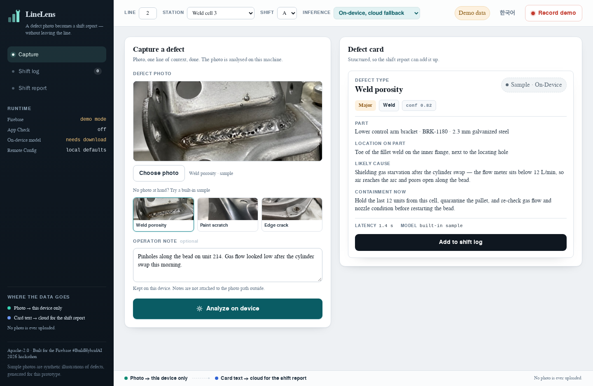
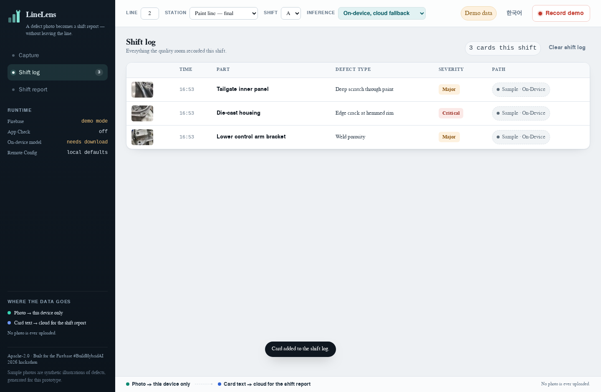
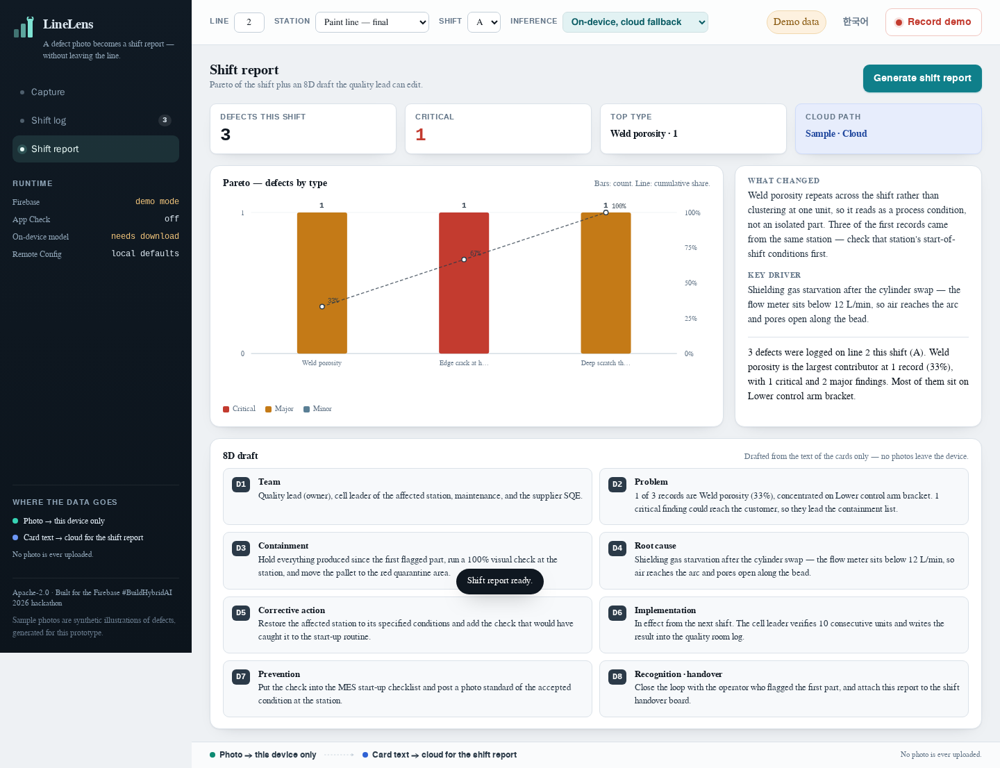

# LineLens

**A defect photo becomes a shift report — without leaving the line.**

LineLens is a static web app for the quality room of an automotive parts plant. An operator photographs a
defective part, types one line of context, and gets a structured defect card in about two seconds. The photo
is read **on the device** by Chrome's built-in model — it is never uploaded. At the end of the shift, the cards
are added up into a Pareto and an editable 8D draft, and **only their text** goes to Gemini in the cloud.

Built for **Firebase #BuildHybridAI 2026** (Web / Chrome track) with Firebase AI Logic hybrid inference.



| Shift log | Shift report |
| --- | --- |
|  |  |

*Screenshots come from the built-in demo mode, where each card is labelled `Sample · On-Device` on purpose.*

---

## Why both paths, and why that is the design

| Job | Path | Why it cannot be the other one |
| --- | --- | --- |
| Photo → structured defect card | `PREFER_ON_DEVICE` / `ONLY_ON_DEVICE` | The part is unreleased and photographed with its drawing marks. Plant security rules forbid uploading it, and the Wi-Fi shadow behind the press line has no signal. A 9,216-token single-turn window with JPEG input is exactly enough for one judgement. |
| 40–80 cards → Pareto, trend, 8D draft | `ONLY_IN_CLOUD` (`gemini-3.8-flash`) | Tens of cards of text plus pattern finding is far outside the on-device window. This is the only step that leaves the machine, and it carries **zero images**. |

Remove either path and the product stops working: cloud-only breaks the security rule and the signal
requirement; on-device-only cannot read the whole shift. The badge on every card says which path actually
answered (`On-Device`, `Cloud Fallback`, `Cloud`), read from `response.inferenceSource`.

```
operator photo ──► Chrome built-in model (on device) ──► defect card (JSON)
                        photo never leaves the laptop          │
                                                               ▼
                                          shift log (localStorage, no images stored)
                                                               │  text digest only
                                                               ▼
                                        Gemini in the cloud ──► Pareto + 8D draft
```

## What is in the box

- **Capture** — drag a photo, pick a file, or use one of three built-in sample defects. Memo field, line /
  station / shift context, and an inference-mode selector (on-device preferred, on-device only, cloud only for
  testing the fallback badge).
- **Defect card** — part, defect type, category, severity, location, likely cause, immediate containment,
  confidence, latency, model, and the inference-path badge.
- **Shift log** — every card of the shift, with thumbnails and the path each one took. Persisted in
  `localStorage`; mirrored to Firestore when a project is configured (text fields only — no images, ever).
- **Shift report** — local Pareto of the shift, plus a cloud-written 8D draft. A consent step shows exactly
  what will leave the device (0 images, N text records) before anything is sent.
- **Runtime panel** — Firebase connection, App Check, on-device model availability, Remote Config values.
- **Demo recorder** — one button records this tab (`getDisplayMedia` with `preferCurrentTab`) and downloads a
  `.webm`; "Run guided demo" plays a scripted 40-second pass for the submission video.
- **English UI by default, Korean toggle** in the header (English is what the hackathon requires).
- **No build step.** HTML + CSS + ES modules, Firebase JS SDK 13.4.0 from the CDN.

## Run it

```bash
cd linelens
python3 -m http.server 8080
# open http://localhost:8080
```

Any static server works (`npx serve`, `firebase serve`, GitHub Pages, Firebase Hosting). ES modules and
`getDisplayMedia` need `http://localhost` or `https://`; opening `index.html` from the file system will not
work.

### Demo mode (default)

`firebase-config.js` is **not committed** (`.gitignore`): a fresh clone has no config, so the app runs in
**demo mode**. The UI, samples, log, Pareto, consent step and recorder all work, and analysis comes from a
rule-based sample engine. Every card in demo mode is labelled `Sample · On-Device` and the header shows a
`Demo data` pill — the prototype never presents sample output as model output.

### Live mode

1. Copy `firebase-config.example.js` to `firebase-config.js` and fill in the values of your Firebase Web app.
   The file stays local; only the example ships with the repo. These are public identifiers, not secrets, but
   they are kept out of version control so the deployed project's key is never mistaken for a placeholder.
2. Enable **AI Logic** and choose the **Gemini Developer API** provider (the Vertex/Agent Platform provider
   requires billing).
3. Register the web app in **App Check** with the **reCAPTCHA Enterprise** provider and paste the site key as
   `appCheckSiteKey`. App Check has been mandatory for AI Logic since 2026-11-02; add `localhost` to the
   reCAPTCHA allowed domains for local testing.
4. (Optional) Create a Firestore database. Rules should allow only the fields the app writes; images are never
   sent.
5. Serve the folder over `https` (Firebase Hosting or GitHub Pages) and open it in **Chrome desktop 139+**.

For the on-device path, Chrome needs `chrome://flags/#prompt-api-for-gemini-nano-multimodal-input` enabled and
a machine that meets Chrome's built-in AI hardware requirements. On the first request Chrome downloads the
model in the background; `PREFER_ON_DEVICE` does not wait for it and answers from the cloud instead, which is
exactly what the `Cloud Fallback` badge reports. The runtime panel shows `needs download` / `downloading` /
`ready` / `unavailable` so the room knows which state it is in.

### Remote Config keys

| Key | Default | Effect |
| --- | --- | --- |
| `report_model` | `gemini-3.8-flash` | Cloud model for the shift report |
| `fallback_model` | `gemini-3.5-flash-lite` | Cloud model used when the on-device path is unavailable |
| `analysis_mode` | `prefer_on_device` | Initial inference mode for capture |
| `max_records_per_report` | `60` | How many cards go into one report digest |

Values are fetched and activated at start-up (`minimumFetchIntervalMillis` 60 s) and shown in the runtime
panel; with no project the panel says `local defaults`.

## Recording the demo video

1. Open the app in Chrome on the plant laptop, at `https://` or `localhost`.
2. Press **Record demo** → Chrome asks once which surface to share → pick **This Tab**.
3. Press **Run guided demo**: it photographs a sample, analyses it, saves three cards, opens the consent
   step, and writes the report — then stops and downloads `linelens-demo-<timestamp>.webm`.
4. For the offline proof shot (DevTools → Network → Offline, then analyse a photo), do it by hand after the
   scripted pass: on-device capture keeps working with the network off. Record it the same way.

## Data and privacy

- **Photo**: decoded in the page, sent to the on-device model only. Never in a network request. No upload
  code path exists for images — the cloud request is built from text fields (`src/aggregate.js`).
- **Stored on the device**: the shift log in `localStorage`, including a 120 px thumbnail for the log list.
  Cards mirrored to Firestore contain text fields only.
- **Sent to the cloud**: the report digest (counts, stations, part names, defect types, causes) and the
  operator memo if it was typed. The consent dialog shows the record count and that images sent = 0.
- **Sample photos** in `assets/samples/` are synthetic illustrations generated for this prototype, not
  photos of any customer's parts.
- No Analytics, no third-party scripts beyond the Firebase SDK CDN.

## File map

```
index.html                markup, EN/KO strings via data-i18n
style.css                 all styling (no framework)
app.js                    UI wiring, views, consent, recorder hooks
firebase-config.example.js  template for the local, uncommitted firebase-config.js
src/i18n.js               English / Korean UI strings
src/inference.js          the only place that picks an inference path
src/prompts.js            prompts and response schemas (on-device constraint + cloud schema)
src/firebase.js           lazy Firebase init: AI Logic, App Check, Remote Config, Firestore mirror
src/aggregate.js          counts, Pareto data, text digest (no images)
src/report.js             SVG Pareto chart, 8D renderer
src/recorder.js           getDisplayMedia + MediaRecorder demo capture
src/mock.js               demo-mode sample engine (clearly labelled)
src/samples.js            built-in sample metadata
assets/samples/*.jpg      three synthetic defect photos
```

`window.LineLens` exposes the small API the Playwright checks use (`setPhotoFromSample`, `runAnalysis`,
`saveRecord`, `runReport`); it is also handy for driving a demo from the console.

## Known limits

- On-device defect reading quality is not benchmarked. The card is a draft for a human decision, and the
  prompt asks for "likely" causes, not verdicts.
- On-device output has no `generationConfig`, so the JSON schema is enforced with Chrome's
  `responseConstraint` and parsed tolerantly; a malformed answer shows an error instead of a card.
- The cloud report is written from the text digest only. It cannot see photos by design, so it reasons about
  counts and causes, not geometry.
- Shift-to-shift trend comparison uses only what the digest carries; there is no history database yet.

## License

Apache-2.0. See [LICENSE](LICENSE).
